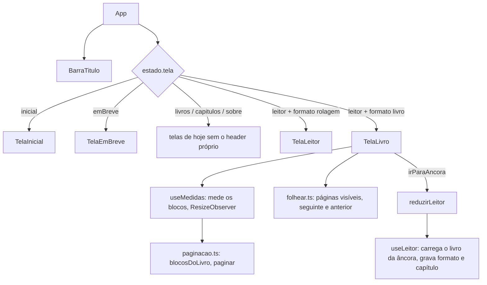

# interface-livro Design

**Spec**: `.specs/features/interface-livro/spec.md`
**Reconhecimento**: `.specs/features/interface-livro/reconhecimento.md` · **Mockup**: `.specs/features/interface-livro/mockup/` (aprovado em 2026-11-17)
**Status**: Draft

**Abordagem escolhida** (usuário, 2026-11-17): paginação por **medir e agrupar**: o app mede a altura real de cada bloco do livro aberto numa área invisível com a mesma largura e letra da página, e uma função pura agrupa os blocos em páginas. As alternativas descartadas foram as colunas do CSS (regra presa ao navegador, sem teste unitário possível) e a estimativa por caracteres (não garante FUN-75).

---

## Architecture Overview

O estado continua num reducer puro (`src/estado/leitor.ts`) ligado ao aparelho por `useLeitor`. A feature acrescenta ao estado o **formato** (rolagem ou livro), a **âncora** do modo livro (o primeiro versículo visível, ou a capa) e duas telas (`inicial`, `emBreve`). Medir é trabalho do componente; agrupar e navegar entre páginas são funções puras em `src/livro/`. Como a âncora é um versículo, e não um número de página, trocar a letra, girar a tela ou trocar de formato nunca perde o lugar (FUN-70, FUN-71, FUN-86).



---

## Code Reuse Analysis

### Existing Components to Leverage

| Component | Location | How to Use |
| --- | --- | --- |
| Reducer do leitor | `src/estado/leitor.ts:58` | Estender: telas `inicial` e `emBreve`, campos `formato`, `ancora` e `voltarPara`, ações novas |
| useLeitor | `src/estado/useLeitor.ts:48` | Estender: lê e grava o formato; carrega o livro da âncora; grava o capítulo da âncora (FUN-85) |
| Preferências | `src/dados/preferencias.ts:86-95` (tema) | Molde de `lerFormato`/`gravarFormato`, chave `mj:formato` |
| Navegação entre capítulos | `src/navegacao/navegacao.ts:11-43` | `refValida` valida a âncora; a lógica de livro seguinte e anterior serve de molde para as bordas de livro |
| Deslize | `src/navegacao/deslize.ts:9` | `classificarDeslize` igual, passando página (FUN-79, FUN-80) |
| Carga do livro | `src/dados/livros.ts:53` | Sem mudança: o livro carregado é o da âncora, um por vez |
| Segmentos | `src/biblia/segmentos.ts:9` | Itálico dos acréscimos dentro da página |
| PainelAparencia | `src/componentes/PainelAparencia.tsx:28` | Sobe do `TelaLeitor` para a `BarraTitulo` sem mudança |
| Botões | `src/componentes/base/Botoes.tsx` | `BotaoIcone`, `BotaoPrimario`, `BotaoSecundario`, `BotaoVoltar` |
| Estado | `src/componentes/base/Estado.tsx:22` | "Em breve" (vazio), página carregando, sem rede (FUN-87) |
| Mensagem sem rede | `src/telas/TelaLeitor.tsx:31` (`MENSAGEM_NAO_BAIXADO`) | Reaproveitada na página do livro |
| CSS da barra | `src/telas/comum.module.css` | Base da `BarraTitulo` |
| Mockup | `mockup/componentes.css`, `mockup/barra.js`, `mockup/telas/*.html` | Molde visual e de classes de cada tela nova |

### Integration Points

| System | Integration Method |
| --- | --- |
| localStorage | Chave nova `mj:formato`; `mj:leitura` continua `{livro, capitulo}` e passa a ser gravada também pelo modo livro |
| Service worker / pré-cache | `vite.config.ts:55-58` ganha `webp` no `globPatterns` para a foto da inicial (FUN-58) |
| Manifesto e ícones | `public/icones/*` trocados pelo ícone 2a (FUN-93, FUN-94); manifesto em `vite.config.ts:38-53` sem mudança de nomes |
| CSP (`public/_headers:5`) | Sem mudança: a foto é arquivo do próprio site, maior que 4 KiB (não vira `data:`); estilo dinâmico só por CSSOM (propriedade `style` do React), permitido sem `unsafe-inline` (AD-003) |

---

## Components

### Estado: `src/estado/leitor.ts` (estender)

- **Purpose**: Telas, formato e âncora do modo livro, num reducer puro.
- **Interfaces**:
  - `type Tela = 'inicial' | 'livros' | 'capitulos' | 'leitor' | 'sobre' | 'emBreve'`
  - `type Formato = 'rolagem' | 'livro'`
  - `type Ancora = { tipo: 'capa' } | { tipo: 'pago' } | { tipo: 'texto'; ref: Ref; versiculo: number } | { tipo: 'fim'; livro: number }`. `fim` é "a última página deste livro", resolvida pela `TelaLivro` depois de paginar (anterior na primeira página de um livro, FUN-78).
  - `EstadoLeitor` ganha `formato: Formato`, `ancora: Ancora` e `voltarPara: Tela` (para o "Voltar" da tela "em breve").
  - Ações novas: `lerBiblia` (FUN-54 a FUN-56), `trocarFormato` (FUN-67, FUN-70, FUN-71), `abrirEmBreve` e `voltar` (FUN-57), `irParaAncora` (passar página, FUN-77, FUN-78, FUN-82, FUN-88, FUN-90). `iniciar` passa a abrir `inicial` (FUN-51) e recebe o formato gravado.
  - `abrirCapitulo` no formato livro também põe a âncora no versículo 1 do capítulo (FUN-83). `irParaAncora` com âncora de texto atualiza `ref` para o capítulo dela (FUN-84, FUN-85).
- **Reuses**: `refValida` (`src/navegacao/navegacao.ts:35`).

### useLeitor: `src/estado/useLeitor.ts` (estender)

- **Purpose**: Ligar o estado novo ao aparelho.
- **Interfaces**: devolve também `lerBiblia()`, `trocarFormato()`, `abrirEmBreve()`, `voltar()`, `irParaAncora(a)`.
- **Comportamento**: grava `mj:formato` quando muda (FUN-68); com a âncora de texto, grava o `ref` dela (FUN-85); na capa e no pago não grava nada. O livro a carregar é o da âncora (`texto.ref.livro` ou `fim.livro`), com o mesmo ciclo carregando → pronto | naoBaixado (AD-004, FUN-87).

### Preferências: `src/dados/preferencias.ts` (estender)

- `lerFormato(): Formato` (padrão `rolagem`, FUN-66 e FUN-69) e `gravarFormato(f: Formato): void` (FUN-68), no molde de `lerTema`/`gravarTema`.

### Paginação: `src/livro/paginacao.ts` (novo, puro)

- **Purpose**: Transformar um livro em blocos e os blocos em páginas.
- **Interfaces**:
  - `type Bloco = { tipo: 'nomeLivro'; livro: number } | { tipo: 'versiculo'; ref: Ref; versiculo: number; abreCapitulo: boolean }`
  - `blocosDoLivro(livro: Livro): Bloco[]`: o nome do livro e depois todos os versículos na ordem; o primeiro versículo de cada capítulo leva `abreCapitulo` (FUN-76).
  - `type Pagina = { partes: { bloco: number; recorte: number }[] }`: `recorte` é quanto do topo do bloco já saiu na página anterior (0 para bloco inteiro).
  - `paginar(alturas: number[], alturaPagina: number, alturaLinha: number): Pagina[]`: guloso; põe blocos inteiros enquanto cabem; bloco que não cabe numa página vazia é dividido em fatias de altura múltipla de `alturaLinha` (FUN-75). Entradas inválidas (altura da página menor que uma linha, lista vazia) dão uma página vazia, sem laço infinito.
  - `paginaDoVersiculo(paginas, blocos, versiculo: {ref, versiculo}): number` e `primeiroVersiculo(pagina, blocos)`: localizar a âncora e ler a âncora de uma página.

### Folhear: `src/livro/folhear.ts` (novo, puro)

- **Purpose**: Qual página (ou par) mostrar e para onde vão "seguinte" e "anterior".
- **Interfaces**:
  - `visiveis(pagina: number, larga: boolean): number[]`: em tela larga, o par que começa na página par (FUN-73); na estreita, só a página (FUN-74).
  - `destinoSeguinte(atual, total, livro, larga): { pagina: number } | { ancora: Ancora } | null` e `destinoAnterior(...)`, com o mesmo retorno: dentro do livro, a página (ou par) seguinte; na última, o versículo 1 do livro seguinte (FUN-82); em Apocalipse, `null` (FUN-81); na primeira página, `fim` do livro anterior; em Gênesis, `capa` (larga) ou `pago` (estreita, AD-005); na capa, `null` (FUN-91). Sequência da capa: larga [pago | capa] → Gênesis; estreita capa → pago → Gênesis (FUN-89, FUN-90).

### useTelaLarga: `src/livro/useTelaLarga.ts` (novo)

- `useTelaLarga(): boolean` com `matchMedia('(min-width: 900px) and (orientation: landscape)')`, ouvindo mudanças (FUN-73, FUN-74, FUN-86).

### useMedidas: `src/livro/useMedidas.ts` (novo)

- **Purpose**: Medir os blocos de um livro na largura e na letra da página.
- **Interfaces**: `useMedidas(blocos, chave): { ref: RefObject<HTMLDivElement>; medidas: { alturas: number[]; alturaPagina: number; alturaLinha: number } | null }`. Renderiza os blocos num contêiner invisível (`visibility: hidden`, fora do fluxo, `aria-hidden`), mede com `getBoundingClientRect` e remede quando `chave` muda (letra, tema, livro) ou quando o `ResizeObserver` da página avisa outro tamanho (FUN-86).
- **Teste**: jsdom não tem layout; o hook recebe a função de medir por parâmetro, e o teste unitário injeta alturas. A medição real é provada no E2E.

### Componentes do livro (novos)

| Componente | Location | Purpose |
| --- | --- | --- |
| `PaginaLivro` | `src/livro/PaginaLivro.tsx` | Uma página: nome do livro, número do capítulo grande, versículos com número pequeno e itálico; parte recortada por `transform`; rodapé com capítulo e número da página (mockup `telas/livro.html`) |
| `CapaLivro` | `src/livro/CapaLivro.tsx` | Capa vinho com "Bíblia Sagrada", "Bíblia Livre" e "MinhaJornada" (FUN-89) |
| `PaginaPago` | `src/livro/PaginaPago.tsx` | Selo "Em breve", texto do plano de estudo e "Quero saber" → tela "em breve" (FUN-92) |
| `TelaLivro` | `src/telas/TelaLivro.tsx` | Junta tudo: título-botão (FUN-84), 1 ou 2 páginas, setas e deslize por página (FUN-77 a FUN-81), capa, carregando, sem rede (FUN-87); resolve a âncora `fim` depois de paginar; ao mudar a página, despacha `irParaAncora` com o primeiro versículo dela (FUN-85) |

### Barra e telas (novos e alterados)

| Componente | Location | Purpose |
| --- | --- | --- |
| `BarraTitulo` | `src/componentes/BarraTitulo.tsx` | Marca (vai à inicial), formato, "Aa" com `PainelAparencia`, Sobre, "Entrar / Criar conta"; presa ao topo; abaixo de 480 px a conta vira ícone (FUN-60 a FUN-65, FUN-72) |
| `TelaInicial` | `src/telas/TelaInicial.tsx` | Foto de fundo com véu, cartão "Ler Bíblia" / "Criar conta", crédito da foto; sem foto, a cor do tema (FUN-52, FUN-53, FUN-59) |
| `TelaEmBreve` | `src/telas/TelaEmBreve.tsx` | `Estado` vazio com o texto da conta e do plano, "Voltar" e "Ler Bíblia" (FUN-57) |
| `TelaLeitor`, `TelaLivros`, `TelaCapitulos`, `TelaSobre` | `src/telas/*` | Perdem o `<header>` próprio; `TelaLivros` mantém "voltar à leitura" como `BotaoVoltar` no topo do conteúdo; `TelaSobre` ganha o crédito da foto |
| Ícones | `src/componentes/icones.tsx` | `IconeLivroAberto`, `IconeRolagem`, `IconeConta` (mockup `barra.js`) |

---

## Data Models

```typescript
type Formato = 'rolagem' | 'livro';              // mj:formato, padrão 'rolagem'
type Ancora =
  | { tipo: 'capa' }
  | { tipo: 'pago' }                              // só existe na tela estreita (AD-005)
  | { tipo: 'texto'; ref: Ref; versiculo: number }
  | { tipo: 'fim'; livro: number };               // transitória: vira 'texto' depois de paginar
```

`mj:leitura` não muda de forma: `{ livro, capitulo }`. A âncora não é gravada; ao reabrir, o modo livro mostra a página onde o capítulo gravado começa (FUN-54, FUN-70).

---

## Error Handling Strategy

| Error Scenario | Handling | User Impact |
| --- | --- | --- |
| Livro da página seguinte ou anterior sem rede e fora do cache | `useLeitor` marca `naoBaixado` (AD-004); `TelaLivro` mostra `Estado` erro com `MENSAGEM_NAO_BAIXADO` e "Escolher outro livro" | FUN-87: mensagem no lugar da página, seletor disponível |
| `mj:formato` ilegível ou desconhecido | `lerFormato` devolve `rolagem` | FUN-69 |
| Leitura gravada inválida | `lerLeitura` já apaga na abertura (`preferencias.ts:57-63`); "Ler Bíblia" age como sem leitura | FUN-56 (AD-006) |
| Foto de fundo não carrega | `onError` da `` esconde a foto; fundo na cor do tema, cartão legível | Página inicial continua usável |
| Medição ainda não pronta (primeira pintura, livro trocando) | `TelaLivro` mostra o `Estado` carregando no lugar das páginas | Sem página vazia nem corte |
| Altura da página menor que uma linha (janela minúscula) | `paginar` devolve uma página por bloco, sem laço infinito | Texto aparece, ainda que apertado |
| Âncora aponta versículo inexistente (livro mudou de versão) | `paginaDoVersiculo` cai na primeira página do capítulo, ou na primeira do livro | Nenhuma tela quebrada |

---

## Risks & Concerns

| Concern | Location (file:line) | Impact | Mitigation |
| --- | --- | --- | --- |
| jsdom sem layout | — | Teste unitário não prova a medição | `paginar` e `folhear` puros, com alturas injetadas; `useMedidas` com função de medir injetável; a prova real fica nos E2E (tarefas T31 a T34), com asserção espacial por `boundingBox` |
| Pré-cache não guarda WebP | `vite.config.ts:55-58` | Foto some sem rede (FUN-58) | Acrescentar `webp` ao glob, na mesma tarefa da foto, com teste de configuração e E2E sem rede |
| Imagem pequena vira `data:` e a CSP bloqueia | `public/_headers:5`, Vite `assetsInlineLimit` | Foto quebra em silêncio | A foto tem cerca de 150 KB; o teste de configuração confere que o arquivo gerado é maior que 4 KiB e que o build o emite como arquivo |
| Favicon SVG inválido hoje | `public/icones/icone.svg:2` (`--` no comentário) | Favicon não aparece | FUN-94: tarefa do ícone com teste que faz o parse XML do SVG |
| Barra duplicada em 4 telas | `TelaLeitor.tsx:93-117`, `TelaLivros.tsx:30-41`, `TelaCapitulos.tsx:38-47`, `TelaSobre.tsx:22` | Mexe em 4 telas e nos testes delas | `BarraTitulo` única no `App`; os testes da barra antiga mudam para `BarraTitulo.test.tsx` (pedido de autorização na aprovação do plano) |
| 26 usos dos helpers E2E dependem da abertura antiga | `e2e/apoio/navegar.ts:4-30` | E2E inteiro vermelho | Uma tarefa ajusta os helpers para passar por "Ler Bíblia" (mudança autorizada pela spec) |
| Livro grande (Salmos, 2.461 versículos) medido de uma vez | `src/livro/useMedidas.ts` | Primeira pintura do livro mais lenta | Mede uma vez por livro, letra e tamanho; a medição usa um só contêiner e lê as alturas numa passada (sem layout intercalado). Se passar de 300 ms num celular médio, vira tarefa de performance |
| `TelaLeitor.tsx` com 184 linhas | `src/telas/TelaLeitor.tsx` | Mais difícil de mexer | Só perde o header e o painel; o modo livro é tela nova |

---

## Tech Decisions

| Decision | Choice | Rationale |
| --- | --- | --- |
| Paginação | Medir e agrupar (escolha do usuário) | Exata, testável, nunca corta versículo |
| Estado do lugar no livro | Âncora = primeiro versículo visível, não número de página | Sobrevive à troca de letra, tela e formato (FUN-70, FUN-71, FUN-86) |
| Livro carregado | Um por vez, o da âncora | Reaproveita `useLeitor` e AD-004 sem pré-carregar vizinhos; a troca de livro vem do cache em milissegundos |
| Página em tela larga | Pares dentro do livro; livro com número ímpar de páginas termina com a direita vazia | Cada livro começa numa página nova (FUN-76) e à esquerda |
| Formato da foto | WebP de 1920 px, qualidade 75, em `src/estilo/imagens/inicial.webp`, importada pela `TelaInicial` | Cerca de 150 KB; entra no pré-cache com o glob ampliado e ganha hash no nome |
| Ícones PNG | Gerados do SVG 2a por script com o Chromium do Playwright (já instalado) | Sem dependência nova |
| Breakpoint de duas páginas | `(min-width: 900px) and (orientation: landscape)` | Premissa da spec; token `--quebra-livro-duplo` |

Decisões de projeto e divergências entre spec e design: AD-005 e AD-006 em `.specs/STATE.md`.
