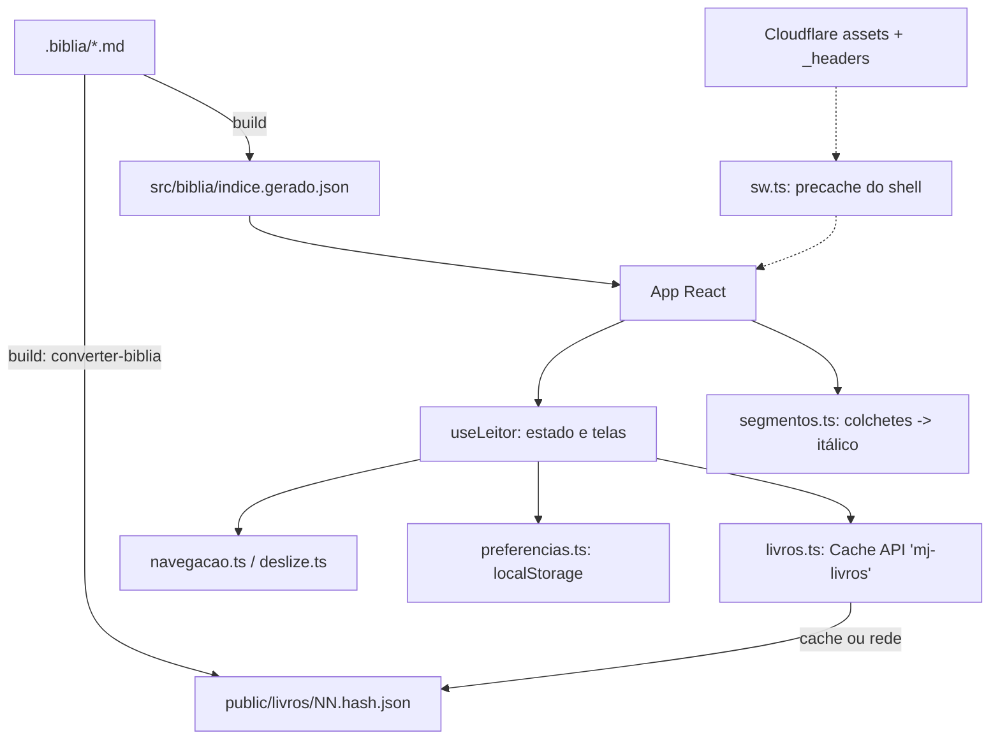

# Design: Leitor bíblico

**Spec**: `.specs/features/leitor/spec.md`
**Status**: Approved (pelo usuário em 2026-11-14)
**Mockup**: `.specs/mockup/` (direção C · Leve e legível; `tokens.css`, `guia.html`, telas `leitor`, `capitulos` e `livros`), aprovado pelo usuário em 2026-11-14. Galeria: https://claude.ai/artifact/19jcsNtt92tACKs7pKtnTU; direções (histórico): https://claude.ai/artifact/FxqCsHDJGhDKK9Zk3fL33C. Letra e tema ficam no painel "Aa" do leitor.
**Base**: `context.md`, `viabilidade-tecnica.md`, molde `c:\Leandro\Projetos\ControleEmCasa_LJS` (`frontend/web`), em 2026-11-14

---

## Architecture Overview

O leitor é um site estático, uma PWA de página única, sem servidor de aplicação e sem banco (AD-001). No build, o texto de `.biblia/` vira um JSON por livro, com o hash do conteúdo no nome do arquivo, e um índice que entra no bundle. O app abre só o livro da leitura e, depois que o primeiro capítulo aparece, guarda os outros livros num cache próprio (AD-002). O service worker precacheia só o app (o shell). As preferências e a leitura atual ficam no `localStorage`. A publicação é a Cloudflare (Workers só com assets), e os cabeçalhos vêm do `public/_headers` (AD-003).



Telas, sem rotas de URL, só estado (`tela`): **Livros** (AT e NT) → **Capítulos** (grade) → **Leitor**; **Sobre**, a partir do leitor. Tocar no título do leitor abre a grade do livro atual, com "Trocar livro" (FUN-49); em livro de capítulo único, abre a lista de livros (FUN-50). Outro capítulo do mesmo livro fica a 2 toques; outro livro, a 3 (decisão do usuário em 2026-11-14, spec ajustada).

---

## Code Reuse Analysis

### Existing Components to Leverage

| Component | Location | How to Use |
| --------- | -------- | ---------- |
| Config da PWA | `ControleEmCasa_LJS/frontend/web/vite.config.ts:34-58` | Copiar `VitePWA` (`injectManifest`, `srcDir: 'src/pwa'`, `injectRegister: false`, ícones 192/512/maskable) e a leitura da cor de `tokens.css` (`:11`, `:30`); trocar nome e `scope` para `/` |
| Service worker | `.../src/pwa/sw.ts:13-14, 20-25, 31-32` | Copiar precache, `cleanupOutdatedCaches`, fallback de navegação e `skipWaiting`/`clients.claim`; tirar push e a rota de API (`:17`) |
| Registro do SW | `.../src/pwa/registrarSW.ts:4-6` | Copiar |
| Detecção de instalação | `.../src/pwa/instalacao.ts:44, 98` | Molde da chave de dispensa no `localStorage`; o convite do iOS é novo |
| Cabeçalhos | `.../public/_headers:4-9` + `.../src/cabecalhos.test.ts:12-36` | Copiar a CSP e o teste; **trocar** `Referrer-Policy: no-referrer` por `same-origin` (FUN-42); sem `gerar-headers.mjs` (só existia para o Sentry) |
| Vitest | `.../vite.config.ts:62-94`, `.../test/setup.ts:1-23` | Dois projetos: `componentes` (jsdom + jest-dom + polyfill de `matchMedia`) e `arquivos` (node); tirar `fake-indexeddb` |
| Playwright | `.../playwright.config.ts:5-18` | Copiar (Chromium, `127.0.0.1`); o `webServer` passa a ser `vite preview` do build, porque o SW só existe no build |
| Lint | `.../eslint.config.mjs:90, 168, 175-176` + `test/lint/regras.test.ts` | Copiar o bloqueio de `dangerouslySetInnerHTML`/`innerHTML` (FUN-04), `fetch` só em `src/dados/` e `no-eval` |
| CI e deploy | `.github/workflows/ci.yml:16-38, 82-97, 145-153`, `deploy.yml:35-57, 87-132` | Molde para o `/preparar`: job `base`, `e2e-web`, gitleaks, `conferir` + `publicar` + smoke de cabeçalhos; sem migração, Hyperdrive nem Neon |
| Workspace | `package.json:5-8, 31`, `pnpm-workspace.yaml:11-12`, `.nvmrc`, `.gitignore` | Node `>=24 <25`, pnpm 11, `blockExoticSubdeps`, `minimumReleaseAge: 1440` |

Um pacote só, na raiz, sem monorepo: não há backend.

### Integration Points

| System | Integration Method |
| ------ | ------------------ |
| `.biblia/*.md` | Lido só no build por `scripts/converter-biblia.ts` (Node 24 roda `.ts` direto); a saída fica fora do git |
| Cloudflare Workers (assets) | `wrangler.jsonc` só com `assets.directory: "dist"` e `not_found_handling: "single-page-application"`, sem `main`; configurado no `/preparar` |
| Navegador | Cache API (`mj-livros`), `localStorage` (prefixo `mj:`), `matchMedia('(prefers-color-scheme: dark)')` e `('(display-mode: standalone)')`, Pointer Events |

---

## Components

### Conversor da Bíblia

- **Purpose**: Transformar cada `.biblia/NN-slug.md` em JSON e montar o índice.
- **Location**: `src/biblia/conversor.ts` (puro) e `scripts/converter-biblia.ts` (CLI, roda em `predev` e `prebuild`)
- **Interfaces**:
  - `converterLivro(md: string, numero: number): Livro`: lê `# <Nome>`, `## <Nome> <n>` e `**<v>** texto`, tira o espaço do fim e **falha** se o capítulo ou o versículo sair da sequência 1, 2, 3...
  - `montarIndice(livros: Livro[], arquivos: string[]): Indice`
- **Dependencies**: nenhuma (o CLI usa `node:fs` e `node:crypto`)
- **Reuses**: nada; o formato da fonte foi conferido em 2026-11-14: 31.102 versículos, numeração sem saltos e 6.096 trechos entre colchetes, nenhum aninhado ou desbalanceado

### Segmentos do versículo

- **Purpose**: Separar os trechos entre colchetes, que viram itálico sem os colchetes (FUN-02).
- **Location**: `src/biblia/segmentos.ts`
- **Interfaces**: `segmentar(texto: string): Segmento[]`
- **Dependencies**: nenhuma
- **Reuses**: nada. O texto vira nó de texto do React; não há HTML interpretado (FUN-04, lint G-36).

### Navegação

- **Purpose**: Regras de seguinte, anterior e limites entre livros (FUN-10 a FUN-15), validação da referência gravada (FUN-22) e classificação do deslize (FUN-16 a FUN-18).
- **Location**: `src/navegacao/navegacao.ts`, `src/navegacao/deslize.ts`
- **Interfaces**:
  - `seguinte(ref: Ref, indice: Indice): Ref | null` e `anterior(ref, indice): Ref | null` (`null` = botão desativado)
  - `refValida(valor: unknown, indice: Indice): Ref | null`
  - `classificarDeslize(dx: number, dy: number): 'seguinte' | 'anterior' | null` (`|dx| >= 60` e `|dx| > |dy|`; `dx < 0` = seguinte)
- **Dependencies**: índice
- **Reuses**: nada

### Preferências

- **Purpose**: Ler e gravar a leitura atual, a letra, o tema e a dispensa do convite, com recaída no padrão quando o valor gravado é inválido (FUN-19 a FUN-22, FUN-30, FUN-31, FUN-47).
- **Location**: `src/dados/preferencias.ts`
- **Interfaces**: `lerLeitura()`, `gravarLeitura(ref)`, `apagarLeitura()`, `lerLetra(): 1..5` (padrão 3), `gravarLetra(n)`, `lerTema(): Tema | null`, `gravarTema(t)`, `conviteDispensado(): boolean`, `dispensarConvite()`
- **Dependencies**: `localStorage` (chaves `mj:leitura`, `mj:letra`, `mj:tema`, `mj:convite-ios`)
- **Reuses**: molde de chave única de `.../src/dados/sessao.ts:13-23`

### Livros (dados e offline)

- **Purpose**: Carregar um livro pelo cache ou pela rede, guardar em segundo plano os que faltam e limpar as versões antigas (FUN-33, FUN-34, FUN-36).
- **Location**: `src/dados/livros.ts`
- **Interfaces**:
  - `carregarLivro(numero): Promise<Livro>`: `caches.match`, senão `fetch` e `cache.put`; sem rede e sem cache, lança `LivroNaoBaixado`
  - `baixarFaltantes(indice): Promise<void>`: um livro por vez, pulando os que já estão no cache, para que a interrupção não perca o que já foi baixado
  - `limparAntigos(indice): Promise<void>`: apaga do `mj-livros` as URLs que não estão no índice atual
- **Dependencies**: Cache API, `fetch`, índice
- **Reuses**: regra de lint "`fetch` só em `src/dados/`"

### Estado do leitor

- **Purpose**: Guardar a tela atual, a referência, o livro carregado, a letra e o tema; abrir onde parou (FUN-20, FUN-21) e disparar `baixarFaltantes` depois do primeiro capítulo renderizado (FUN-33).
- **Location**: `src/estado/useLeitor.ts` (reducer puro + gancho)
- **Interfaces**: `useLeitor(): { estado, abrirCapitulo(ref), escolherLivro(n), seguinte(), anterior(), mudarLetra(+1|-1), escolherTema(t), irPara(tela) }`
- **Dependencies**: navegação, preferências, livros
- **Reuses**: nada

### Telas e componentes

- **Location**: `src/telas/` (`TelaLivros`, `TelaCapitulos`, `TelaLeitor`, `TelaSobre`) e `src/componentes/` (`base/` do guia, `Versiculo`, `BarraLeitor`, `ConviteInstalacao`, `AvisoNaoBaixado`), com CSS Modules e cores, letras e medidas só de `src/estilo/tokens.css` (cópia de `.specs/mockup/tokens.css`)
- **Notas**: no `TelaLeitor`, o título "<Livro> <n>" é o botão que abre a grade do livro atual (FUN-01, FUN-49, FUN-50), e a grade tem "Trocar livro" (FUN-06); a rolagem vai ao topo a cada capítulo (FUN-05); os gestos são Pointer Events na área do texto, com `touch-action: pan-y`; todo botão de ícone tem `aria-label` em português (FUN-44); o tamanho da letra fica em `data-letra` e o tema em `data-tema` no `<html>`, sem estilo inline (CSP)
- **Tema padrão** (FUN-29): sem `data-tema`, o CSS usa `@media (prefers-color-scheme: dark)`, sem JS e sem piscar

### PWA

- **Location**: `src/pwa/sw.ts`, `src/pwa/registrarSW.ts`, `src/pwa/instalacao.ts`
- **Interfaces**: `ehSafariIOS(ua, plataforma, toques): boolean` e `estaInstalado(): boolean` (`display-mode: standalone` ou `navigator.standalone`) para o convite (FUN-46 a FUN-48)
- **Atualização** (FUN-37): o SW novo chama `skipWaiting()` e `clients.claim()` **sem recarregar a página**. A leitura em curso continua com o JS já carregado (bundle sem chunks preguiçosos), e a abertura seguinte já usa a versão nova
- **Manifesto** (FUN-45): nome "MinhaJornada", `display: standalone`, ícones 192, 512 e maskable

---

## Data Models

```typescript
// public/livros/NN.<hash8>.json
interface Livro {
  numero: number            // 1..66, ordem canônica
  nome: string              // "Gênesis", "1 Samuel"
  capitulos: string[][]     // capitulos[c-1][v-1] = texto cru, com colchetes
}

// src/biblia/indice.gerado.json (entra no bundle)
interface Indice {
  livros: { numero: number; nome: string; testamento: 'AT' | 'NT'; capitulos: number; arquivo: string }[]
}  // testamento: 1..39 = AT, 40..66 = NT

type Ref = { livro: number; capitulo: number }
type Tema = 'claro' | 'escuro' | 'sepia'
type Segmento = { texto: string; italico: boolean }
```

O número do versículo é a posição + 1; o conversor falha se a fonte tiver um salto, e por isso a posição é segura.

---

## Error Handling Strategy

| Error Scenario | Handling | User Impact |
| -------------- | -------- | ----------- |
| Sem rede e livro fora do cache | `LivroNaoBaixado` capturado no estado | Mensagem "Este livro ainda não foi baixado. Conecte-se à internet para lê-lo." com o seletor de livro disponível (FUN-36) |
| Valor gravado ilegível ou fora do intervalo | `refValida`/leitores de preferência devolvem `null` ou o padrão; a leitura inválida é apagada | Abre na escolha de livro (FUN-22), ou com letra 3 e tema do sistema (FUN-31) |
| Download em segundo plano falha no meio | Livros já guardados ficam; o erro é engolido e registrado no console | Nada visível; completa na próxima abertura com rede (FUN-33) |
| Cota ou Cache API indisponível | `cache.put` falha e é ignorado; leitura segue pela rede | Lê com rede; offline mostra a mensagem de FUN-36 |
| `localStorage` indisponível (modo privado antigo) | `try/catch` nas leituras e gravações | Funciona sem lembrar a leitura |
| Fonte `.biblia` fora do formato | Conversor lança e o build falha | Nenhum: nunca publica texto truncado |

---

## Risks & Concerns

| Concern | Location (file:line) | Impact | Mitigation |
| ------- | -------------------- | ------ | ---------- |
| Molde usa `Referrer-Policy: no-referrer` | `ControleEmCasa_LJS/frontend/web/public/_headers:8`, `src/cabecalhos.test.ts:34` | Diverge da FUN-42 e faz o Chromium enviar `Origin: null` | Copiar com `same-origin` e o teste já ajustado |
| Teste do molde lê `sw.ts` como texto | `.../src/pwa/configuracaoSw.test.ts:185, 231-254` | Frágil a refatoração e não prova comportamento | Não copiar; provar offline e atualização por E2E no build (`vite preview`, `context.setOffline`) |
| Teste de manifesto faz build dentro do Vitest | `.../test/pwa/manifesto.test.ts:30-47` | Lento (até 180 s) | Validar o manifesto no `dist/` pelo E2E do build, que já existe para o SW |
| Dependências pesadas do molde | `.../frontend/web/package.json:22-29` | Bundle maior que o necessário | Não trazer Sentry, TanStack Query, react-router, idb-keyval nem `workbox-window`; só `workbox-precaching` e `workbox-routing` no SW |
| Safari não instalado apaga o cache após 7 dias sem uso | `viabilidade-tecnica.md`, incerteza 1 | Offline some no iPhone | Convite de instalação (FUN-46); `navigator.storage.persist()` pedido depois do download completo, sem depender dele; o texto se baixa de novo com rede |
| SW com defeito preso no aparelho | — | Versão quebrada até o usuário limpar dados | `skipWaiting` + `clients.claim` (FUN-37) com E2E de atualização: dois builds com versões diferentes no mesmo contexto |
| Teste de FUN-03 sobre 31.102 versículos | — | Lento se for pela interface | Teste no projeto `arquivos` (node): converte todos e compara com a fonte linha a linha; a interface prova amostras (Filemom 1, Salmos 119) |

---

## Tech Decisions (only non-obvious ones)

| Decision | Choice | Rationale |
| -------- | ------ | --------- |
| Front | React 19 + Vite 8 + vite-plugin-pwa 2 (`injectManifest`), Node 24, pnpm 11 | Escolha do usuário em 2026-11-14: mesmo molde dos outros PWAs (AD-001) |
| Livros fora do precache | Cache `mj-livros` gerido pelo app, um livro por vez | Precache seria tudo ou nada na instalação do SW; por livro, o download retoma de onde parou e o primeiro capítulo não espera os outros (AD-002) |
| Nome com hash | `NN.<hash8>.json` | Texto novo gera URL nova; o cache nunca serve versão velha sem querer, e `limparAntigos` apaga o resto |
| Navegação por estado, sem rotas | `tela` no reducer | Links por URL estão fora do escopo; dispensa react-router |
| Preferências em `localStorage` | Leitura síncrona na abertura | Abre o capítulo e aplica a letra sem esperar; os dados são 4 chaves pequenas |
| Tema do sistema só em CSS | `prefers-color-scheme` sem `data-tema` | Sem script inline (CSP) e sem piscar |
| Letra | 5 níveis em `data-letra`; valores em px no `tokens.css` do mockup | Faixa da spec; o mockup fixa os valores |
| Fontes | Do sistema ou auto-hospedadas | FUN-41: nada de outro domínio |
| Cabeçalhos | `public/_headers` estático (AD-003) | Sem Sentry, o gerador do molde não tem motivo |

## Conferência spec × design

| Ponto | Spec | Design | Decisão |
| ----- | ---- | ------ | ------- |
| Dados no aparelho | Só leitura, letra, tema e convite | Também guarda o texto dos livros na Cache API | Sem conflito: o texto é conteúdo público do app, não dado do leitor; a premissa trata de preferências. Registrado aqui, sem AD |
| CSP "restrita à própria origem" | FUN-42 | `default-src 'self'` com `script-src`, `style-src`, `img-src`, `connect-src`, `manifest-src` e `worker-src` em `'self'`, `object-src 'none'`, `base-uri 'none'`, `form-action 'none'` e `frame-ancestors 'none'` | Atende (AD-003) |

| Dois toques | Objetivo: "qualquer capítulo em no máximo 2 toques a partir do leitor" | No celular, a lista de livros não cabe ao lado do texto | Spec ajustada em 2026-11-14 com o usuário: grade do livro atual primeiro (FUN-49, FUN-50); mesmo livro em 2 toques, outro livro em 3 |

Não há outra divergência.
