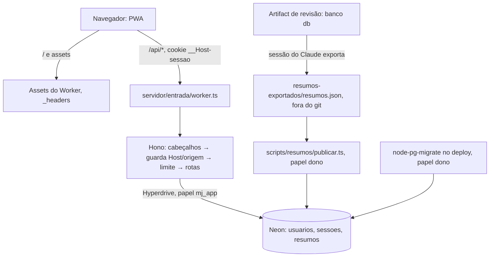

# Resumo do livro: design

**Spec**: `.specs/features/resumo-livro/spec.md` (FUN-137 a FUN-176) · **Reconhecimento**: `reconhecimento.md` · **Mockup**: `mockup/` (aprovado em 2026-11-20) · **Reuso**: `reuso.md`
**Status**: Approved

A abordagem já está fixada pela AD-022 (padrão dos projetos irmãos); não há alternativas a comparar. Decisões novas desta feature: papel restrito `mj_app` no banco e propostas escritas por tarefa do `/executar` (escolhas do dono em 2026-11-20).

---

## Architecture Overview

Um Worker só. Com `run_worker_first: ["/api/*"]`, o que não é `/api/*` sai dos assets como hoje (`public/_headers`, AD-003); `/api/*` entra no app Hono. O texto do resumo existe só no Neon e no banco do artifact de revisão.



Ordem dos middlewares em `/api/*`: cabeçalhos (vale também para as recusas) → Host (421) → origem em método que muda estado (403) → rota. O limite (429/503) só em `POST /api/entrar`, antes de ler o corpo.

## Code Reuse Analysis

### Existing Components to Leverage

| Component | Location | How to Use |
| --- | --- | --- |
| `Estado` (carregando, erro, ação) | `src/componentes/base/Estado.tsx:30-66` | Estados do resumo, como `TelaCorrecoes.tsx:51-93` |
| `Aviso` variante `erro` | `src/componentes/base/Aviso.tsx:13` | "E-mail ou senha incorretos." e "Muitas tentativas…" |
| `BotaoPrimario`, `BotaoIcone` | `src/componentes/base/Botoes.tsx:13`, `:40` | Botão "Entrar"; "Resumo" com `aria-pressed` (molde `PainelAparencia.tsx:58`) |
| Preferências `mj:` | `src/dados/preferencias.ts:111-117` | Chave `mj:resumo` (FUN-157) e `mj:dono` (dica sem rede) |
| `voltarPara` | `src/estado/leitor.ts:36`, `:100-104`, `:179-183` | Generalizado para a tela `entrar` |
| `visiveis`, `destinoSeguinte`, `destinoAnterior` | `src/livro/folhear.ts:29-81` | Sem mudança de código: a tela passa `duasPaginas` (larga e resumo desligado) no lugar de `larga` para o texto; a capa continua com `larga` (`destinoDaCapa`, FUN-159) |
| `useMedidas`, `paginar` | `src/livro/useMedidas.ts:58`, `src/livro/paginacao.ts:73` | `useMedidas` passa a genérico (`readonly unknown[]`); o resumo vira uma lista de blocos de texto e usa `paginar` sem quebras |
| Revisão em artifact | `src/revisao/pagina.ts:10-58`, `revisao/vite.config.ts`, `revisao/LEIA-ME.md` | Molde da revisão dos resumos (`DbLike`, `textContent`) |
| `validarCorrecoes`, `semControle`, `nomeRef` | `src/biblia/correcoes/validar.ts:5-8`, `:74`, `:89` | Caracteres de controle (AD-018) e nome da referência no validador do resumo |
| `vi.stubGlobal('fetch')`; `page.route('**/api/**')` | `src/dados/livros.test.ts:14`; e2e | Testes do front sem servidor |

### Integration Points

| System | Integration Method |
| --- | --- |
| Worker atual (só assets) | `wrangler.jsonc` ganha `main`, `run_worker_first`, `compatibility_flags: ["nodejs_compat"]` (o `pg` precisa), `vars.URL_PUBLICA`, `hyperdrive`, `ratelimits`, `workers_dev: false`, `preview_urls: false`, no topo e em `env.tst` |
| Service worker | `/^\/api\//` na denylist da navegação (`src/pwa/sw.ts:16`); nenhuma rota de cache para `/api/*` |
| CI | Serviço `postgres:18` no job `base`, `DATABASE_URL_TESTE` |
| Deploy | Passo de migração (papel dono, segredo só nele) antes do `wrangler deploy`; fumaça de `/api/resumos/1` (401 e `no-store`) |

## Components

### Servidor (`servidor/`)

- **`entrada/worker.ts`**: `export default { fetch(req, env, ctx) }` → `criarApp(depsDoEnv(env)).fetch(req, env, ctx)`. Só ligação; coberto pelo typecheck e pela fumaça.
- **`app.ts`**: `criarApp(deps: Deps): Hono`. `Deps = { conectar(): ClienteRequisicao; urlPublica: string | undefined; limiteEntrar: RateLimit | undefined; agora?(): Date; log?(linha: string): void }`. Testes injetam o Postgres local e um limite falso; o Worker injeta Hyperdrive e o binding.
- **`middlewares/cabecalhos.ts`**: `Cache-Control: no-store`, `X-Content-Type-Options: nosniff`, CSP `default-src 'none'; frame-ancestors 'none'`, `Referrer-Policy: same-origin` em toda resposta, inclusive 4xx e 5xx (FUN-151).
- **`middlewares/guarda.ts`**: `recusa(req, urlPublica): Response | null` — sem `URL_PUBLICA` válida, 500 (falha fechada); Host diferente do da URL, 421; método fora de GET e HEAD com `Sec-Fetch-Site` presente e fora de `same-origin`/`none`, ou `Origin` presente e diferente da origem da URL (inclusive `null`), 403; compara sem caixa.
- **`middlewares/limite.ts`**: `limiteEntrar(binding)`: binding ausente, 503; chave `entrar:<CF-Connecting-IP>` (sem IP, `entrar:sem-ip`); negado, 429 com `Retry-After: 60` e `{ erro: 'limite' }` (FUN-140).
- **`db/cliente.ts`**: `criarCliente(url)` abre na primeira consulta; `emTransacao(cliente, fn)` faz `BEGIN`/`COMMIT`, `ROLLBACK` no erro; o app fecha a conexão no fim de toda requisição (`finally`). Erro de conexão vira 500 genérico.
- **`sessao/token.ts`**: `gerarToken()` (32 bytes, base64url, 43 caracteres), `hashToken(t): Uint8Array` (SHA-256), `tokenTemFormato(t)`.
- **`sessao/cookie.ts`**: `__Host-sessao`, HttpOnly, Secure, SameSite=Lax, Path=/, `Max-Age` de 30 dias; `lerToken(req)` recusa cookie repetido ou fora do formato.
- **`repositorios/sessoes.ts`**: `criar(usuarioId)`, `validar(token): { usuarioId, dono } | null` (um SQL: apaga e devolve `null` se `criada_em` passou de 30 dias ou `usada_em` de 7; senão renova `usada_em` quando passou de 60 s), `apagar(token)`.
- **`repositorios/usuarios.ts`**: `entrar(email, senha): string | null` via função `usuario_entrar` (hash fixo quando o e-mail não existe, para o tempo ser igual).
- **`repositorios/resumos.ts`**: `buscar(livro): Resumo | null`.
- **`rotas/acesso.ts`**: `GET /api/sessao` (200 `{ dono }` ou 401), `POST /api/entrar` (JSON `{ email, senha }`; 200 `{ dono }` com cookie; 401 `{ erro: 'credenciais' }` igual nos três casos de FUN-139, também para corpo inválido), `POST /api/sair` (204 sempre, apaga a sessão do cookie e expira o cookie).
- **`rotas/resumos.ts`**: `GET /api/resumos/:n` — sem sessão: 401; sem `dono`: 403; `n` não é inteiro de 1 a 66: 400; sem resumo: 404; senão 200 com o `Resumo` (AD-024: a sessão vem antes da validação do livro).
- **Log**: uma linha por requisição, `MÉTODO rota status`, com `/api/resumos/:n` como modelo de rota; nunca corpo, cookie, e-mail nem texto.
- **`migracoes/`** (SQL do `node-pg-migrate`) e **`migrar.ts`** (`runner` com `checkOrder`, lock do próprio `node-pg-migrate`).

### Formato e validação (`src/resumos/`)

- **`formato.ts`**: tipos `Resumo`, `EstadoResumo = 'proposta' | 'aprovada' | 'recusada'`, `ItemRevisao = { livro, estado, resumo, nota? }`, `ArquivoExportado = { formato: 'mj-resumos-v1', itens: ItemRevisao[] }`; `lerArquivoExportado(json): ArquivoExportado` (forma estrita).
- **`validar.ts`**: `contarPalavras(resumo)`; `problemasDoResumo(resumo, biblia): string[]` (300 a 450 palavras, seção vazia, divisão com capítulo fora do livro ou intervalo invertido, versículo-chave que não existe, caractere de controle ou de formatação, AD-018). Roda no script de publicação e na tarefa das propostas; não entra no pacote do app.

### Scripts (`scripts/resumos/`)

- **`publicar.ts --ambiente tst|producao [--arquivo resumos-exportados/resumos.json]`**: URL do banco só da variável `DATABASE_URL_TST` ou `DATABASE_URL_PRODUCAO` (nunca de arquivo); lê e valida **todos** os aprovados; qualquer problema: lista `Livro: problema`, sai com código 1 e não conecta; produção: pede que se digite `PRODUÇÃO` (outra resposta encerra sem gravar); grava numa transação (`INSERT … ON CONFLICT (livro) DO UPDATE`); imprime `N livros gravados`.
- **`criar-dono.ts --email <e-mail>`**: senha lida da entrada padrão; cria ou atualiza o usuário com `dono = true`. Papel dono.

### Front

- **`src/dados/sessao.ts`**: `lerSessao(): Promise<'dono' | 'usuario' | 'sem' | 'rede'>`, `entrar(email, senha): Promise<'dono' | 'usuario' | 'incorreto' | 'limite' | 'rede'>`, `sair(): Promise<void>`. Grava `mj:dono` ao confirmar sessão de dono e apaga em `sem` e no `sair`.
- **`src/dados/resumos.ts`**: `buscarResumo(livro): Promise<{ situacao: 'pronto'; resumo } | { situacao: 'semResumo' } | { situacao: 'semSessao' } | { situacao: 'erro' }>` (rede, 5xx, 400, 403 e JSON inválido → `erro`; 401 → `semSessao`).
- **`src/estado/useSessao.ts`**: `{ sessao, entrar, sair, perder }`. Na abertura: `lerSessao()`; com `rede`, vale `mj:dono` (caso limite "sem internet com sessão guardada"). `perder()` (401 de qualquer chamada, FUN-145) volta a `sem` sem mensagem.
- **`src/estado/leitor.ts`**: tela `entrar`; ação `abrirEntrar` guarda `voltarPara`; `voltar` serve `emBreve` e `entrar`.
- **`src/telas/TelaEntrar.tsx`**: e-mail, senha, "Entrar", link "Criar conta" (→ "em breve"); `fetch` nunca por `<form>` (CSP `form-action 'none'`): `onSubmit` com `preventDefault`.
- **`src/componentes/BarraTitulo.tsx`**: com sessão, "Sair" no lugar de "Entrar / Criar conta"; prop opcional `resumo?: { pressionado: boolean; aoAlternar(): void }`, botão logo depois do de formato, só ícone abaixo de 640 px.
- **`src/livro/PaginaResumo.tsx`**: busca (`useResumo`), estados de FUN-166 a FUN-168, quatro seções em texto (FUN-163 a FUN-165), cabeçalho "Resumo · <livro>", paginação própria com `useMedidas` + `paginar` e rodapé "‹ 1 de 2 ›" (FUN-169); região `aria-label="Resumo de <livro>, página X de Y"`. Letra da interface (`--texto-m`).
- **`src/telas/TelaLivro.tsx`**: props novas `resumo: 'desligado' | 'lado' | 'sozinho'` e `paginaResumo: ReactNode`. `lado` (larga, ligado): `duasPaginas = false`, Bíblia à esquerda com `lado="esquerda"`, resumo à direita, posição "página X de Y". `sozinho` (estreita, resumo na tela): só o resumo, sem "Anterior/Seguinte" da Bíblia e sem deslize; a âncora não muda (FUN-161). Capa e plano pago ignoram o resumo (FUN-159).
- **`src/App.tsx`**: guarda `resumoLarga` (persistido, `mj:resumo`) e `resumoEstreita` (memória, começa desligado e desliga ao trocar de livro); o botão alterna o da largura atual; `pressionado` mostra o da largura atual. Botão só com sessão `dono`, formato livro e âncora de texto ou fim (FUN-153).

### Revisão (`src/revisao-resumos/`, `revisao-resumos/`)

- **`logica.ts`**: `aprovar(item, editado?)`, `recusar(item, nota)` (nota vazia ou só espaço: erro), `exportar(itens): ArquivoExportado`.
- **`pagina.ts`**: lista dos livros com estado, as quatro seções editáveis (`textarea`), aprovar, recusar com nota, "Baixar exportação" (capacidade `downloads`); banco do artifact `resumos/<livro>` (`DbLike`, molde `src/revisao/pagina.ts:16-58`); todo texto por `textContent`.
- **`revisao-resumos/vite.config.ts`, `LEIA-ME.md`**: monta o artifact e descreve o caminho escrever → revisar → exportar → publicar, sem código novo por livro.

## Data Models

```sql
-- servidor/migracoes/<data>_inicial.sql (papel dono)
CREATE EXTENSION IF NOT EXISTS pgcrypto;
CREATE TABLE usuarios (
  id uuid PRIMARY KEY DEFAULT gen_random_uuid(),
  email text NOT NULL UNIQUE CHECK (email = lower(email)),
  senha_hash text NOT NULL,                 -- crypt(senha, gen_salt('bf', 12)): bcrypt (FUN-141)
  dono boolean NOT NULL DEFAULT false,
  criado_em timestamptz NOT NULL DEFAULT now()
);
CREATE TABLE sessoes (
  token_hash bytea PRIMARY KEY,             -- SHA-256 do token (FUN-141)
  usuario_id uuid NOT NULL REFERENCES usuarios(id) ON DELETE CASCADE,
  criada_em timestamptz NOT NULL DEFAULT now(),
  usada_em timestamptz NOT NULL DEFAULT now()
);
CREATE TABLE resumos (
  livro smallint PRIMARY KEY CHECK (livro BETWEEN 1 AND 66),
  conteudo jsonb NOT NULL,
  publicado_em timestamptz NOT NULL DEFAULT now()
);
-- usuario_entrar(email, senha) RETURNS uuid: SECURITY DEFINER, search_path fixo, hash fixo sem conta;
-- REVOKE ALL ON FUNCTION ... FROM PUBLIC; GRANT EXECUTE TO mj_app.
-- Papel mj_app (LOGIN, criado no /preparar; a migração só concede):
--   usuarios: SELECT (id, dono) apenas; resumos: SELECT; sessoes: SELECT, INSERT, UPDATE (usada_em), DELETE.
```

```typescript
interface Resumo {
  livro: number;                 // 1 a 66
  contexto: string;
  mensagem: string;              // "Mensagem central"
  divisao: { titulo: string; de: number; ate: number }[];         // "Capítulos de a ate"
  versiculos: { capitulo: number; versiculo: number; ate?: number; frase: string }[]; // "Gênesis 12:1-3"
}
```

**Contagem de palavras (FUN-174):** contexto + mensagem + títulos da divisão + frases dos versículos-chave; títulos de seção, intervalos e referências não contam. Palavra = sequência de letras ou dígitos (`\p{L}\p{N}`, com hífen e apóstrofo internos).

## Error Handling Strategy

| Error Scenario | Handling | User Impact |
| --- | --- | --- |
| Banco fora ou consulta falha | 500 `{ erro: 'interno' }`, log só com rota e status | "Não foi possível carregar o resumo…" e "Tentar de novo" (FUN-167); no login, a mesma mensagem de rede da tela |
| Binding de limite ausente | 503 (falha fechada, AD-022) | Login indisponível; a fumaça e o teste de configuração mostram |
| `URL_PUBLICA` ausente | 500 em toda `/api/*` | Nada vaza; a fumaça falha e o deploy volta |
| Cookie inválido, vencido ou repetido | 401; sessão vencida é apagada | Volta ao estado sem sessão sem mensagem (FUN-145) |
| `/api/sessao` sem rede | `mj:dono` decide o botão | Botão "Resumo" aparece; ao ligar, FUN-167 |
| Publicação com problema | Nada é gravado, lista por livro, código 1 | Dono corrige na revisão e exporta de novo |
| Conexão cai no meio da publicação | Transação única, `ROLLBACK` | Nenhum livro gravado pela metade |

## Risks & Concerns

| Concern | Location (file:line) | Impact | Mitigation |
| --- | --- | --- | --- |
| `larga` faz duas coisas (duas páginas e capa em par) | `src/telas/TelaLivro.tsx:110,116-117,177,209`; `src/livro/folhear.ts:29,58,77,88` | Ligar o resumo pode quebrar a capa em par (FUN-88, FUN-89, AD-005) | `duasPaginas` só no texto; a capa continua com `larga`; testes de FUN-159 e os de capa existentes |
| `TelaLivro.tsx` com 270 linhas | `src/telas/TelaLivro.tsx` | Mais um modo deixa a tela difícil de mudar | O resumo fica em `PaginaResumo.tsx`; a tela só escolhe o arranjo |
| `_headers` não vale para respostas do script | `public/_headers` | API sem CSP e `nosniff` | Cabeçalhos no Hono, com teste em toda resposta, inclusive recusas; fumaça confere `/api/resumos/1` |
| `not_found_handling` SPA com `run_worker_first` | `wrangler.jsonc:6-9` | Rota `/api/x` cair no `index.html` | Hono responde 404 JSON a toda `/api/*` desconhecida; teste da rota e fumaça |
| Ids de `ratelimits` repetidos na conta | `wrangler.jsonc` | Limite compartilhado com outro projeto | Ids livres escolhidos no `/preparar` (G 2001-2005, C 2001-2003, T 3001-3005 e 3101-3105 ocupados) |
| Seletores do e2e usam `aria-label="Leitura em formato livro"` | `src/telas/TelaLivro.tsx:161`, `:239` | Resumo confundir o seletor | Resumo com região de nome próprio; título do capítulo continua sendo o da Bíblia |
| `aria-label` e texto da conta divergem | `src/componentes/BarraTitulo.tsx:85`, `:89` | Leitor de tela | "Sair" com o mesmo texto no rótulo e na tela |
| Repositório público | `.gitignore` | Resumo real no git | Pasta `resumos-exportados/` ignorada; teste de arquivo; testes só com texto de exemplo (FUN-152) |
| `src/pwa/sw.ts` sem teste | `src/pwa/sw.ts:16` | `/api` cair na navegação do SW | Teste de arquivo da denylist (FUN-151) |
| Testes do servidor precisam de Postgres | `vite.config.ts:65-88` | Suíte local falha sem banco | Banco local no Nível 1 do `/preparar`; CI com `postgres:18`; banco `teste_<hex>` com `DROP … WITH (FORCE)` no `finally` |

## Tech Decisions

| Decision | Choice | Rationale |
| --- | --- | --- |
| Papel do Worker no banco | `mj_app` restrito; papel dono só em migração, publicação e `criar-dono` | Escolha do dono em 2026-11-20: erro de SQL no Worker não lê a senha nem muda resumos (AD-023) |
| Testes do servidor | Vitest em node com `app.request()` do Hono e Postgres real; sem `@cloudflare/vitest-pool-workers` | O app recebe as dependências; o `worker.ts` é só ligação. Menos uma dependência; o workerd fica para a fumaça |
| Onde ficam as propostas | Banco do artifact de revisão, gravadas pela sessão do Claude; exportação em `resumos-exportados/` | O texto nunca passa pelo git nem pelo pacote (FUN-152) |
| Botão "Resumo" sem rede | Dica `mj:dono` no aparelho (não é credencial) | Caso limite da spec; o texto continua exigindo sessão no servidor |
| Resumo na tela estreita | Estado em memória, separado da preferência da tela larga | FUN-161 e o caso limite "larga → estreita mostra a Bíblia" |
| Validação do resumo | Só no script e na tarefa das propostas | Não pesa no pacote do app; o servidor confia no que o script gravou |
