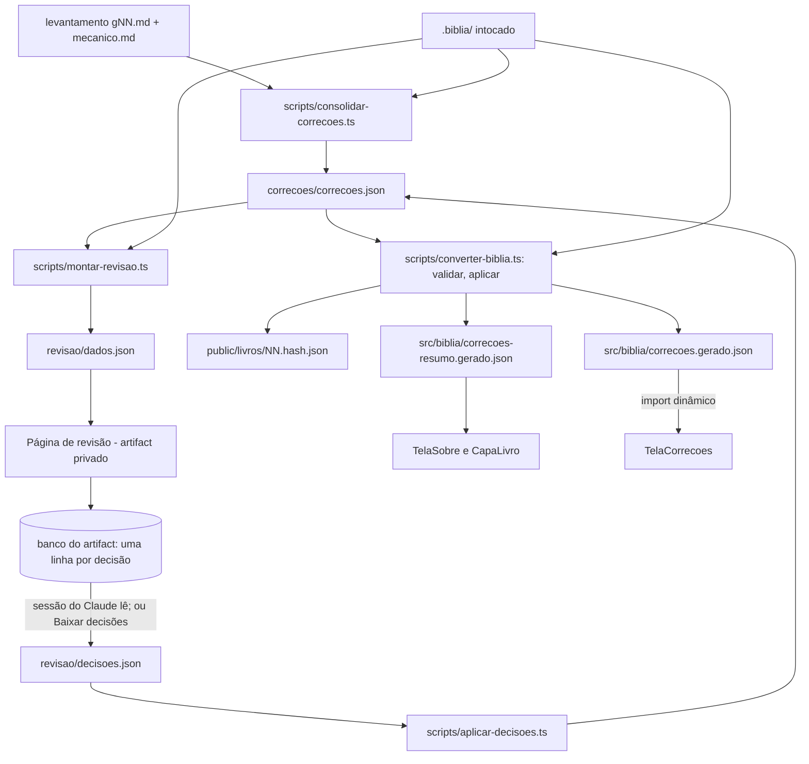

# Texto bíblico corrigido: design

**Spec**: `.specs/features/texto-atualizado/spec.md` (FUN-103 a FUN-127)
**Reconhecimento**: `.specs/features/texto-atualizado/reconhecimento.md` · **Mockup**: `mockup/telas/correcoes.html` (aprovado em 2026-11-18)
**Status**: Approved

Decisões do dono que este design segue (2026-11-18): revisão num artifact privado **com banco** (exportação por uma sessão do Claude e um script testado, com o botão "Baixar decisões" como reserva); lista de correções no app num **pedaço separado**, com um resumo pequeno no código principal. ADs novas: AD-012 a AD-017 (`.specs/STATE.md`).

---

## Architecture Overview

Três partes, ligadas por um único arquivo versionado, `correcoes/correcoes.json`:

1. **Consolidação** (roda uma vez, à mão): lê o levantamento, confere cada candidato contra `.biblia/` e grava o arquivo com tudo em "proposta".
2. **Revisão** (fora do app): uma página no artifact privado mostra os grupos, guarda cada decisão no banco do artifact, e as decisões voltam ao arquivo por `scripts/aplicar-decisoes.ts`.
3. **Build e app**: o conversor valida o arquivo, aplica só as aprovadas ao texto e grava dois dados gerados: o resumo (no código principal) e a lista (pedaço separado). O Sobre, a capa e a tela "Correções no texto" leem esses dados.



---

## Code Reuse Analysis

### Existing Components to Leverage

| Component | Location | How to Use |
| --------- | -------- | ---------- |
| `converterLivro` | `src/biblia/conversor.ts:14` | Parse dos versículos da fonte na consolidação, na montagem da revisão e no build (texto sem espaço final, `:56`) |
| `gerar`, `nomeDoArquivo` | `scripts/converter-biblia.ts:25`, `:14` | Estender `gerar` com o arquivo de correções; o hash do JSON muda sozinho quando o texto muda (FUN-118) |
| `montarIndice` | `src/biblia/conversor.ts:72` | Sem mudança; dá os nomes dos livros para resolver as referências do levantamento |
| `indice.ts` + JSON gerado | `src/biblia/indice.ts:1-5`, `.gitignore` | Molde dos dois dados gerados novos (tipados por cast, fora do git) |
| `limparAntigos`, `baixarFaltantes` | `src/dados/livros.ts:138`, `:102`; chamados em `src/estado/useLeitor.ts:153-155` | Sem mudança: o livro de hash novo substitui o guardado (FUN-118) |
| `segmentar` | `src/biblia/segmentos.ts:9` | Mostra o itálico dos trechos na `TelaCorrecoes` (o leitor nunca vê colchete, FUN-117) |
| `TelaSobre`, `BotaoVoltar`, `Escolha.module.css` | `src/telas/TelaSobre.tsx:19-24`, `src/componentes/base/Botoes.tsx:49` | Molde da `TelaCorrecoes` |
| `Estado` (`carregando`, `erro`, `vazio`) | `src/componentes/base/Estado.tsx:30` | Estados da `TelaCorrecoes` (mockup) |
| `irPara` | `src/estado/leitor.ts:230` | Leva ao `correcoes` e de volta ao `sobre` sem ação nova |
| Vite (modo biblioteca) | `vite.config.ts`, `package.json` | Monta o JS da página de revisão a partir de TypeScript testado |

### Integration Points

| System | Integration Method |
| ------ | ------------------ |
| Build (`prebuild`, `pretest`, `pretypecheck`, `predev`) | `gerar` lê `correcoes/correcoes.json`, ou o arquivo do argumento `--correcoes` (AD-016), e valida tudo **antes** de apagar `public/livros` |
| Pré-cache do service worker | O pedaço da lista é JS: entra no `globPatterns` existente (`vite.config.ts:56`), então abre offline (FUN-124) |
| Artifact privado (claude.ai) | Arquivos da página (`index.html`, JS montado, `dados.json`) publicados por `publish_files`; capacidades `db`, `user` e `downloads` declaradas |

---

## Components

### Tipos e leitura do arquivo

- **Purpose**: Formato do arquivo de correções e leitura validada da forma (FUN-103).
- **Location**: `src/biblia/correcoes/arquivo.ts`
- **Interfaces**:
  - `lerArquivoCorrecoes(json: unknown): ArquivoCorrecoes` - lança `Error` com o caminho do campo inválido (ex.: `itens[12].estado: "aprovado" não é proposta, aprovada nem recusada`)
- **Dependencies**: nenhuma
- **Reuses**: estilo de validação manual de `src/dados/livros.ts:37-45` (sem biblioteca de esquema)

### Regras mecânicas

- **Purpose**: As três regras de espaço e pontuação, puras e idempotentes (FUN-106, FUN-117, FUN-127).
- **Location**: `src/biblia/correcoes/regras.ts`
- **Interfaces**:
  - `REGRAS: readonly RegraMecanica[]` - `{ id: 'R-01' | 'R-02' | 'R-03', descricao, aplicar(texto: string): string }`
  - R-01: tira o espaço antes de `, . ; : ? !` (inclusive depois de `]`)
  - R-02: põe espaço depois de `, ; :` quando vem letra, `[` ou aspas de abertura; nunca entre dígitos (`3:16`), nunca antes de `]`, aspas de fechamento ou outra pontuação
  - R-03: põe espaço depois do ponto quando vem letra maiúscula (`sempre.E` → `sempre. E`)
- **Dependencies**: nenhuma
- **Reuses**: nada; nenhuma regra parecida no projeto

### Validação do arquivo contra a fonte

- **Purpose**: Recusar o arquivo antes de gerar qualquer livro (FUN-107, FUN-115, FUN-125, FUN-126).
- **Location**: `src/biblia/correcoes/validar.ts`
- **Interfaces**:
  - `validarCorrecoes(arquivo: ArquivoCorrecoes, livros: Livro[]): void` - lança na primeira falha, com a mensagem da spec:
    - id repetido ou referência inexistente: `correção <id>: referência <Livro c:v> não existe` / `correção <id>: identificador repetido` (FUN-126)
    - aprovada cujo "antes" não aparece exatamente uma vez: `correção <id> não confere com <Livro c:v>` (FUN-115)
    - duas aprovadas com trechos sobrepostos no mesmo versículo: `correções <id1> e <id2> se sobrepõem em <Livro c:v>` (FUN-107)
    - "depois" com colchete sem par: `correção <id>: colchete de itálico sem par` (FUN-125)
- **Reuses**: forma das mensagens de `converterLivro` (`src/biblia/conversor.ts:21`)

### Aplicação

- **Purpose**: Texto corrigido, determinístico, e a lista do que foi aplicado (FUN-114, FUN-117, FUN-127).
- **Location**: `src/biblia/correcoes/aplicar.ts`
- **Interfaces**:
  - `aplicarCorrecoes(livros: Livro[], arquivo: ArquivoCorrecoes): { livros: Livro[]; aplicadas: ListaAplicada }` - por versículo, primeiro os itens aprovados (do fim do texto para o começo, para as posições não mudarem), depois as regras aprovadas, na ordem R-01, R-02, R-03; conta os versículos que cada regra mudou; não muda os objetos de entrada; mesma entrada dá a mesma saída
- **Dependencies**: `regras.ts`
- **Reuses**: `Livro` (`src/biblia/tipos.ts:2`); a ordem das chaves do JSON do livro não muda (o hash depende dela)

### Build (extensão de `gerar`)

- **Purpose**: Ligar as correções ao build atual.
- **Location**: `scripts/converter-biblia.ts` (modificar)
- **Interfaces**:
  - `gerar(pastaFonte, pastaLivros, arquivoIndice, correcoes: { arquivo: string; lista: string; resumo: string }): Saida` - converte os 66 em memória, lê, valida e aplica as correções, e só então apaga e regrava `public/livros`; grava `correcoes-resumo.gerado.json` e `correcoes.gerado.json`
  - principal: argumento `--correcoes <arquivo>`, padrão `correcoes/correcoes.json` (AD-016); `package.json` ganha `build:e2e` (conversor com o arquivo de exemplo e `vite build`)
- **Reuses**: `gerar`, `nomeDoArquivo`, `montarIndice`

### Dados no app

- **Purpose**: Resumo síncrono e lista sob demanda (FUN-119 a FUN-124).
- **Location**: `src/biblia/correcoesAplicadas.ts`
- **Interfaces**:
  - `resumoCorrecoes: { total: number }` - import estático do resumo gerado (entra no código principal, poucos bytes)
  - `carregarCorrecoes(): Promise<ListaAplicada>` - `import('./correcoes.gerado.json')`, pedaço separado
- **Reuses**: molde de `src/biblia/indice.ts`

### TelaSobre e CapaLivro (modificar)

- `TelaSobre` ganha `totalCorrecoes: number` e `aoVerCorrecoes: () => void`: com total > 0, o parágrafo de FUN-119 e o link-botão "Ver as correções no texto"; com 0, o texto de hoje (FUN-120). `App` passa `resumoCorrecoes.total`.
- `CapaLivro` ganha `baseado?: boolean` (padrão `resumoCorrecoes.total > 0`): "Baseado na Bíblia Livre" ou "Bíblia Livre" (FUN-121).

### TelaCorrecoes (nova)

- **Purpose**: A lista conforme o mockup aprovado (FUN-122, FUN-123, FUN-124).
- **Location**: `src/telas/TelaCorrecoes.tsx`, `src/telas/TelaCorrecoes.module.css`
- **Interfaces**: `TelaCorrecoes({ aoVoltar, carregar = carregarCorrecoes })` - `carregando` enquanto a promessa não volta; `erro` com "Tentar de novo" se falhar; `vazio` se a lista vier sem nada; senão, regras numa linha cada (descrição e "N versículos"), depois os livros na ordem bíblica em `<details>` recolhidos (nome e "N correções"), cada item com referência, `<del>` antes, `<ins>` depois, motivo, e "Antes:"/"Depois:" só para leitor de tela. Livro sem correção não aparece.
- **Reuses**: `BotaoVoltar`, `Estado`, `segmentar`, `indice.livros[n-1].nome`; classes do mockup (`linha-regra`, `livro-correcoes`, `item-correcao`)
- Estado: `Tela` ganha `'correcoes'` (`src/estado/leitor.ts:9`); `App` renderiza a tela com `aoVoltar = irPara('sobre')`.

### Consolidação do levantamento

- **Purpose**: Gerar o arquivo inicial, conferido contra a fonte (FUN-104, FUN-105, FUN-106).
- **Location**: `scripts/correcoes/levantamento.ts` (puro: ler as tabelas), `scripts/correcoes/conferir.ts` (puro: conferir e montar os itens), `scripts/consolidar-correcoes.ts` (I/O)
- **Interfaces**:
  - `lerTabelas(md: string, arquivo: string): { candidatos: Candidato[]; ignoradas: LinhaIgnorada[] }` - uma linha da tabela por candidato; referência pelo nome do livro (`montarIndice`); tira as aspas do trecho; descarta `arcaico` (FUN-104); linha que não se lê vai para `ignoradas` com o motivo, nunca some
  - `conferir(candidatos, livros): { itens: ItemCorrecao[]; relatorio: Relatorio }` - aplica AD-013, AD-014 e AD-015; marca `confere` (FUN-105); ids `C-0001…` na ordem bíblica
  - `descreverRegras(livros): RegraNoArquivo[]` - para cada regra, os versículos que ela muda e 5 exemplos antes/depois (FUN-106)
  - o script grava `correcoes/correcoes.json` (um item por linha, para diff limpo) e `correcoes/relatorio-consolidacao.md` (contagens, ignoradas, não conferem)

### Revisão (fora do app)

- **Purpose**: A revisão do dono e a volta das decisões ao arquivo (FUN-108 a FUN-113).
- **Location**: `src/revisao/logica.ts` (puro), `src/revisao/pagina.ts` (DOM), `revisao/index.html`, `scripts/montar-revisao.ts`, `scripts/aplicar-decisoes.ts`, `src/revisao/mesclar.ts` (puro)
- **Interfaces**:
  - `agrupar(itens, decisoes): Grupos` - regras, blocos (confiança alta, `confere`, sem "itálico muda", por tipo e livro) e um a um (média, baixa, todo `sentido`, não confere, itálico muda), cada um com a contagem de pendentes (FUN-108)
  - `aprovarGrupo(grupo, decisoes): Decisao[]` - só os itens do grupo que conferem (FUN-110)
  - `podeAprovar(item): true | 'Falta a fonte' | 'Não confere'` (FUN-111)
  - `primeiroPendente(grupos, decisoes): string | null` (FUN-112)
  - `mesclarDecisoes(arquivo, decisoes): ArquivoCorrecoes` - muda só estado e "depois" dos itens decididos; recusa id desconhecido; os outros ficam iguais, byte a byte (FUN-113)
  - `montar-revisao.ts` grava `revisao/dados.json`: itens e regras com o versículo inteiro antes e depois (FUN-109), calculado por `aplicarCorrecoes` num versículo
  - a página grava uma linha por decisão no banco (`{ id, estado, depois? }`), lê tudo ao abrir e vai ao primeiro pendente; "Baixar decisões" entrega `decisoes.json`; texto sempre por `textContent`
  - `pnpm revisao:montar` monta `src/revisao/pagina.ts` em `revisao/dist/pagina.js` (Vite, modo biblioteca)

---

## Data Models

```typescript
type Tipo = 'digitacao' | 'ortografia' | 'sentido';
type Estado = 'proposta' | 'aprovada' | 'recusada';
type Confianca = 'alta' | 'media' | 'baixa';
interface Ref { livro: number; capitulo: number; versiculo: number }

interface ItemCorrecao {
  id: string;            // "C-0001", único (FUN-126)
  ref: Ref;
  tipo: Tipo;
  antes: string;         // trecho exato da fonte, com colchetes (AD-015)
  depois: string;
  motivo: string;
  fonte: string;         // vazio = sem fonte (FUN-111)
  confianca: Confianca;
  estado: Estado;
  confere: boolean;      // marca derivada, não estado (AD-012)
  italicoMuda?: true;    // pares de colchetes diferentes entre antes e depois (AD-015)
}

interface RegraNoArquivo {
  id: 'R-01' | 'R-02' | 'R-03';
  descricao: string;
  estado: Estado;
  versiculos: number;                                  // na consolidação (FUN-106)
  exemplos: { ref: Ref; antes: string; depois: string }[]; // 5
}

interface ArquivoCorrecoes { versao: 1; regras: RegraNoArquivo[]; itens: ItemCorrecao[] }

// Gerados no build
interface ResumoCorrecoes { total: number }  // regras aprovadas aplicadas + itens aplicados
interface ListaAplicada {
  regras: { id: string; descricao: string; versiculos: number }[]; // versículos que mudaram neste build (FUN-123)
  itens: { ref: Ref; antes: string; depois: string; motivo: string }[]; // ordem bíblica (FUN-122)
}

interface Decisao { id: string; estado: 'aprovada' | 'recusada'; depois?: string } // linha do banco e de decisoes.json
```

---

## Error Handling Strategy

| Error Scenario | Handling | User Impact |
| -------------- | -------- | ----------- |
| Arquivo com campo inválido, id repetido, referência inexistente, sobreposição, colchete sem par, aprovada que não confere | `throw` com a mensagem da spec, antes de apagar `public/livros`; o `prebuild`/`pretest` cai | Nenhum: o build não publica; quem constrói vê o id e a referência |
| Arquivo de correções ausente | `throw` com o caminho | Idem |
| Pedaço da lista não carrega | `TelaCorrecoes` mostra `erro` com "Tentar de novo" | Leitor vê a mensagem do mockup |
| Decisão com id desconhecido na exportação | `aplicar-decisoes.ts` recusa e não grava nada | Dono vê o id na saída |
| "Depois" editado na página com colchete sem par | A página recusa salvar (mesma checagem de `validar.ts`) e o build recusa de novo | Dono corrige na hora |
| Banco do artifact indisponível | A página avisa e oferece "Baixar decisões" das decisões da visita | Dono não perde a visita |

---

## Risks & Concerns

| Concern | Location (file:line) | Impact | Mitigation |
| ------- | -------------------- | ------ | ---------- |
| `gerar` apaga `public/livros` antes de converter | `scripts/converter-biblia.ts:31-32` | Falha de correção deixaria a pasta pela metade | Converter, validar e aplicar em memória; apagar e gravar só no fim (T5) |
| Teste de FUN-03 compara com a fonte crua | `test/arquivos/converter-biblia.test.ts:52-64` | Quebra com qualquer aprovada | Troca autorizada (`## Autorizações`): fonte + aprovadas, e `.biblia/` provado intocado (T6) |
| Hash depende da ordem das chaves | `scripts/converter-biblia.ts:39` | Mudança de forma geraria hash novo para todos | `aplicar` devolve `Livro` com as mesmas chaves; teste: livro sem correção mantém o hash (T5) |
| "Antes" citado sem colchetes no levantamento | `levantamento/mecanico.md:3` | Muitos "não confere" | Recuperação ignorando colchetes (AD-015) e relatório |
| Regras perto de colchetes, aspas e números | `levantamento/RESUMO.md:18` | Desfazer itálico ou separar "3:16" | Casos limite listados em T2 antes de codar; checagem de pares depois de aplicar (FUN-117) |
| Testes de `src/dados` dependem do índice gerado real | `src/dados/livros.test.ts:3` | Rodam sobre o arquivo real de correções | O arquivo real nasce válido (T10); o `pretest` valida antes |
| E2E roda sobre o build com o arquivo real, cujo conteúdo muda com a revisão | `playwright.config.ts:12-15` | E2E instável | Build do e2e com o arquivo de exemplo (`pnpm build:e2e`, AD-016); teste garante que o deploy usa `pnpm build`, sem `--correcoes` |
| Página de revisão lê texto do arquivo | `src/revisao/pagina.ts` | Injeção de HTML | Só `textContent`; nenhum `innerHTML` (regra do lint vale também ali) |

---

## Tech Decisions (only non-obvious ones)

| Decision | Choice | Rationale |
| -------- | ------ | --------- |
| Formato do arquivo | JSON, um item por linha | Sem biblioteca nova (não há YAML nem zod); diff de uma linha por decisão |
| Regras no arquivo | Só id, descrição, estado, contagem e exemplos; o comportamento está em `regras.ts` | Regra é código testado, não regex em dado |
| Onde mora a lógica da revisão | TypeScript em `src/revisao/`, testado no Vitest, montado para JS | A página fica fora do app, mas a regra (blocos, falta de fonte, mescla) tem teste |
| Ids | `C-0001…` na ordem bíblica, fixos depois de criados | Decisão no banco aponta para o id; reconsolidar não reaproveita ids |
| Segurança padrão de app web | Não se aplica | A feature não cria servidor nem rota; site estático (AD-001), cabeçalhos (AD-003) iguais |
